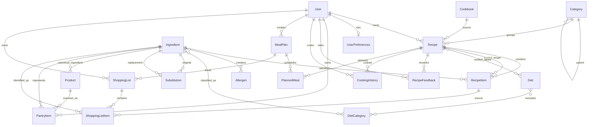

> **Po reorganizacji:** pliki modeli i migracji są w `backend/`, konfiguracja PostgreSQL w `database/compose.yml`. Polecenia uruchomieniowe opisuje [README](../README.md).

# LTC — schemat Django ORM (Kuchnia Polska, wydanie 1985)

Rozwinięcie brancha `feature/recommender`. Zawiera modele i migracje,
bez importowania danych z pliku `recipes(1).json` i bez zmiany obecnego prototypu
rekomendacji (`recommender_prototype/`). Bieżący endpoint produktów nadal działa
na istniejącym `products.Product`.


## Diagram relacji



`User` oznacza standardowy model Django, wskazywany w kodzie przez
`settings.AUTH_USER_MODEL`. Relacje M:N, np. `Ingredient.allergens`, Django
realizuje za pomocą tabel pośrednich.


## Diety i alergie

- `Ingredient.allergens` jest relacją do poznanych alergenów; brak wpisu nie
  oznacza potwierdzonego braku alergenu.
- `DietCategory` określa cechy składników, np. mięso, jaja, nabiał; `Diet`
  definiuje wykluczone kategorie (np. dla weganizmu).
- `Recipe.diets` przechowuje zweryfikowane etykiety przepisów. Nie nadajemy
  ich na podstawie samego tytułu czy niepoprawionych danych OCR.
- `Substitution` ma relację składnik → zamiennik i dodatni współczynnik
  ilościowy `ratio`; rzeczywista zgodność dietetyczna zamiennika wciąż wymaga
  sprawdzenia alergenów.


## Partie spiżarni i sklep

`PantryItem` reprezentuje partię konkretnego zapasu. Dwa opakowania mleka
mogą mieć różne daty ważności. Status `available`, `consumed` lub `discarded`
pozwala przechować historię zakończonych partii. Ilości są dziesiętne,
jednostka (`g`, `kg`, `ml`, `szt.`, `łyżka`, itd.) jest jawna i nie ma automatycznego
przeliczania między rodzajami jednostek. `ShoppingListItem` może wskazywać
`RecipeItem`, więc wiadomo, skąd pochodzi zapotrzebowanie.


## Integracja z prototypem

```python
from recommendations.orm_bridge import recommend_from_database

recommendations = recommend_from_database(request.user, limit=5)
# reshuffle: recommend_from_database(request.user, excluded_recipe_ids={12, 13})
```

To adapter odczytowy. Pobiera dane użytkownika, spiżarnię i historię z ORM,
a następnie wykorzystuje niezmieniony scorer w
`recommender_prototype/recommender.py`.


## Uruchamianie

Z katalogu `product-search/`, z włączonym PostgreSQL z
`test_containers/postgres-test/compose.yml`:

```bash
uv sync
cd test_containers/postgres-test && docker compose up -d && cd ../..
uv run python manage.py check
uv run python manage.py makemigrations --check --dry-run
uv run python manage.py migrate
uv run python manage.py test recipes users pantry recommendations shopping products
uv run python manage.py createsuperuser
uv run python manage.py runserver
```

Panel administratora: `http://127.0.0.1:8000/admin/`.

Test w Django shell (`uv run python manage.py shell`):

```python
from recipes.models import Cookbook, Category, Recipe, RecipeItem
book, _ = Cookbook.objects.get_or_create(title="Kuchnia Polska", edition_year=1985)
section, _ = Category.objects.get_or_create(name="PRZEKĄSKI ZIMNE I GORĄCE", parent=None)
subsection, _ = Category.objects.get_or_create(name="Kanapki", parent=section)
recipe = Recipe.objects.create(
    title="Kanapki z szynką", cookbook=book, category=subsection,
    source_number=1, instructions="Przepis do weryfikacji",
    raw_ingredients=["10 dkg szynki", "2—3 łyżki śmietany"],
)
for n, line in enumerate(recipe.raw_ingredients, start=1):
    RecipeItem.objects.create(recipe=recipe, position=n, raw_text=line)
```

Migracja `recipes.0002_cookbook_1985` tworzy tylko rekord źródła
*„Kuchnia Polska” (1985)* (bez przepisów).


**Nie uruchomiono importu JSON**; można później dodać osobny import
idempotentny z jawnym mapowaniem i raportem jakości.


### Zakres wykonania

Zaimplementowane: struktura danych, relacje, migracje, walidacje, indeksy,
panel admin, testy ORM i adapter do prototypu.

Pozostaje do zrobienia: weryfikacja i import OCR, konwersje jednostek,
pełny algorytm wyliczania braków ilościowych, generowanie list zakupów,
automatyczne odpisywanie stanów magazynu, uprawnienia i kompletne REST API.
Obecne ustawienia `DEBUG=True`, `SECRET_KEY` w kodzie i testowe dane
połączenia PostgreSQL nie nadają się do środowiska pełnego programu.
