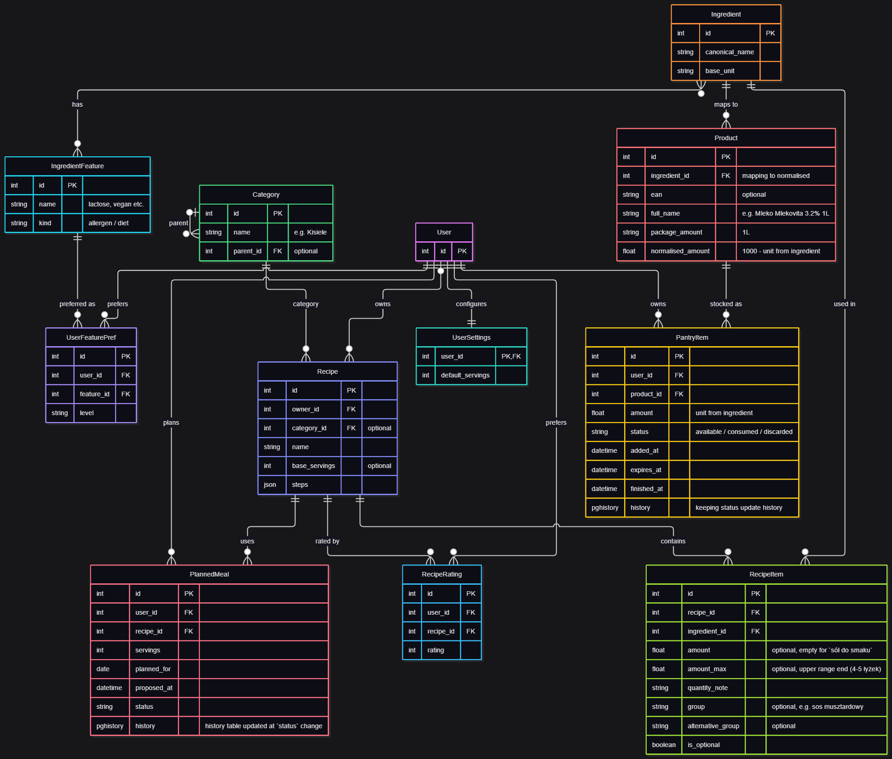

>**UPDATE model v3** (feat/database-diagram): modele zgodne z nowym diagramem — `Recipe.name`, `base_servings`, bez `source_number`, bez `Cookbook`; `RecipeItem.quantity_note` zamiast `position`/`raw_text`/`comment`; `UserSettings` (`default_servings`, klucz `user_id`) zamiast `UserPreferences`; `PantryItem.expires_at`; bez `PlannedMeal.meal_type` i `RecipeRating.updated_at`.

>**UPDATE model v2** (feat/database), w skrócie: usunięcie shopping listy, diety/ alergeny teraz w jednym `IngredientFeature` (`kind`: diet / allergen etc.), bezpośrednie plany posiłków `user <-> PlannedMeal`


> **Po reorganizacji:** pliki modeli i migracji są w `backend/`, konfiguracja PostgreSQL w `database/compose.yml`. Polecenia uruchomieniowe opisuje [README](../README.md).

# LTC — schemat Django ORM (Kuchnia Polska, wydanie 1985)

Rozwinięcie brancha `master`.  Endpointy i serwisy wymagają aktualizacji do obecnych migracji.
## Aktualizowanie struktur bazy
po odpaleniu testowej, więcej w README
### Aplikowanie obecnych migracji (sub_app/migrations/)
```sh
uv run python manage.py migrate
```
### Generowanie kodu migracji (po zmianie modeli)
```sh
uv run python manage.py makemigrations
```

## Model
### Diagram modelu


mermaid: [database.mmd](database.mmd)

`User` oznacza standardowy model Django, wskazywany w kodzie przez `settings.AUTH_USER_MODEL`. Relacje M:N są realizowane przez tabele pośrednie


### Diety i alergie

**IngredientFeature**
- `kind`: diet/ allergen etc.
- `name`

**UserFeaturePref**
- `level`: dislike / avoid / allergy / prefer

Do składników przypisywane jest wiele features, użytkownik może mieć preferencje ustawione dla każdego feature wg. `level`.
### Partie spiżarni i sklep

`PantryItem` reprezentuje partię konkretnego zapasu powiązaną z produktem (`Product`), wskazującym na kanoniczny składnik (`Ingredient`). Dwa opakowania mogą mieć różne daty ważności (`expires_at`). Zmiany statusu (`available`, `consumed`, `discarded`) są automatycznie wersjonowane za pomocą `pghistory`. Ilość (`amount`) zapisywana jest dziesiętnie w jednostce bazowej składnika (`product.ingredient.base_unit`: `g`, `ml`, `pcs`).

>UWAGA: obecnie jest możliwość dodania tylko jednego produktu per ingredient bez podania ean - z założenia ma być unikalnym łącznikiem PantryItem <-> ingredient gdy nie ma danych produktu sklepowego

W module zakupów (`shopping`) nie ma osobnych tabel (np. `ShoppingListItem`) - lista zakupów będzie wyliczana dynamicznie jako różnica zapotrzebowania z zaplanowanych posiłków i dostępnych stanów spiżarni (`SUM(posiłki) - SUM(spiżarnia status=available)`).

# OUTDATED
## Integracja z prototypem

```python
from recommendations.orm_bridge import recommend_from_database

recommendations = recommend_from_database(request.user, limit=5)
# reshuffle: recommend_from_database(request.user, excluded_recipe_ids={12, 13})
```

To adapter odczytowy. Pobiera dane użytkownika, spiżarnię i historię z ORM,
a następnie wykorzystuje niezmieniony scorer w
`recommender_prototype/recommender.py`.


## Uruchamianie

Z katalogu `product-search/`, z włączonym PostgreSQL z
`test_containers/postgres-test/compose.yml`:

```bash
uv sync
cd test_containers/postgres-test && docker compose up -d && cd ../..
uv run python manage.py check
uv run python manage.py makemigrations --check --dry-run
uv run python manage.py migrate
uv run python manage.py test recipes users pantry recommendations shopping products
uv run python manage.py createsuperuser
uv run python manage.py runserver
```

Panel administratora: `http://127.0.0.1:8000/admin/`.

Test w Django shell (`uv run python manage.py shell`):

```python
from recipes.models import Category, Ingredient, Recipe, RecipeItem
section, _ = Category.objects.get_or_create(name="PRZEKĄSKI ZIMNE I GORĄCE", parent=None)
subsection, _ = Category.objects.get_or_create(name="Kanapki", parent=section)
recipe = Recipe.objects.create(
    name="Kanapki z szynką", category=subsection, base_servings=4,
    steps=["Przygotować pieczywo.", "Jajo obrać, pokrajać wzdłuż na cząstki."],
)
ham, _ = Ingredient.objects.get_or_create(canonical_name="szynka", defaults={"base_unit": "g"})
cream, _ = Ingredient.objects.get_or_create(canonical_name="śmietana", defaults={"base_unit": "ml"})
RecipeItem.objects.create(recipe=recipe, ingredient=ham, amount=100)
RecipeItem.objects.create(recipe=recipe, ingredient=cream, amount=30, amount_max=45, quantity_note="2–3 łyżki")
```

Migracja `recipes.0002_cookbook_1985` tworzy tylko rekord źródła
*„Kuchnia Polska” (1985)* (bez przepisów).


**Nie uruchomiono importu JSON**; można później dodać osobny import
idempotentny z jawnym mapowaniem i raportem jakości.


### Zakres wykonania

Zaimplementowane: struktura danych, relacje, migracje, walidacje, indeksy,
panel admin, testy ORM i adapter do prototypu.

Pozostaje do zrobienia: weryfikacja i import OCR, konwersje jednostek,
pełny algorytm wyliczania braków ilościowych, generowanie list zakupów,
automatyczne odpisywanie stanów magazynu, uprawnienia i kompletne REST API.
Obecne ustawienia `DEBUG=True`, `SECRET_KEY` w kodzie i testowe dane
połączenia PostgreSQL nie nadają się do środowiska pełnego programu.
